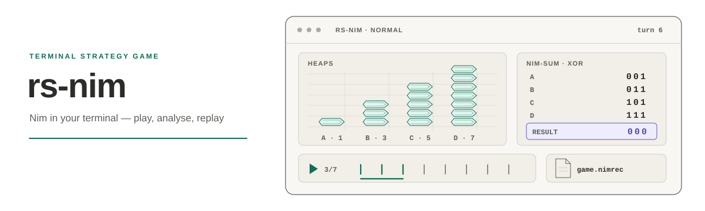

<p align="center"></p>

[English](README.md) | **日本語**

# rs-nim

ターミナルで遊ぶ Nim です．通常ルールとミゼールルールで CPU と対戦でき，ニム和を 2 進数で表示して必勝法を学べます．`.nimrec` 形式の棋譜ファイルから対局を再生でき，録画にも使えます．描画には [ratatui](https://ratatui.rs) を使っています．

## インストール

```sh
cargo install --git https://github.com/akitenkrad/rs-nim
```

クローンして実行する場合:

```sh
cargo run --release
```

端末サイズは 90 × 26 以上が必要です．True Color（24bit）対応の端末を推奨します．

## クイックスタート

```sh
rs-nim                                                   # play against the CPU
rs-nim replay examples/records/classic-1357.nimrec       # replay a game record
```

## ドキュメント

- [遊び方](docs/gameplay.ja.md) — ルール，設定，操作
- [必勝法](docs/strategy.ja.md) — ニム和と Bouton の定理（通常・ミゼール）
- [棋譜とリプレイ](docs/replay.ja.md) — `.nimrec` 形式，リプレイのオプション，録画
- [開発者向け情報](docs/development.ja.md) — ソース構成とテスト

## ライセンス

[MIT](LICENSE)
