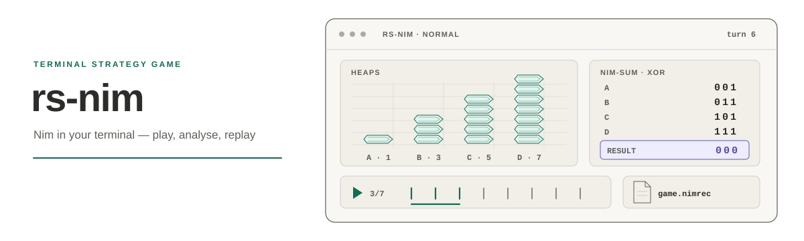

<p align="center"></p>

**English** | [日本語](README.ja.md)

# rs-nim

Nim in your terminal. Play against a CPU under the normal or misère rule, watch the nim-sum in binary to learn the winning strategy, and replay recorded games from `.nimrec` files — handy for recording videos. Built with [ratatui](https://ratatui.rs).

## Install

```sh
cargo install --git https://github.com/akitenkrad/rs-nim
```

Or from a clone:

```sh
cargo run --release
```

A terminal of at least 90 × 26 cells is required; true colour (24-bit) is recommended.

## Quick start

```sh
rs-nim                                                   # play against the CPU
rs-nim replay examples/records/classic-1357.nimrec       # replay a game record
```

## Documentation

- [Playing rs-nim](docs/gameplay.md) — rules, settings and controls
- [Winning strategy](docs/strategy.md) — the nim-sum and Bouton's theorem, normal and misère
- [Game records and replay](docs/replay.md) — the `.nimrec` format, replay options and recording videos
- [Development](docs/development.md) — source layout and tests

## License

[MIT](LICENSE)
